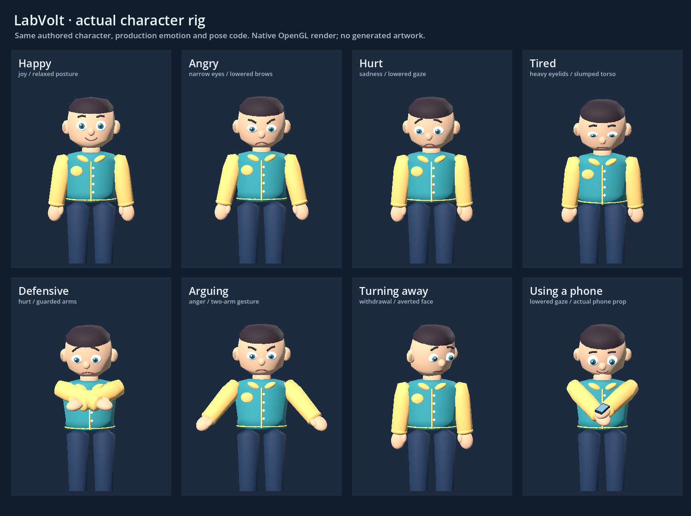

# Character overhaul: implementation and verification

Verification date: 2026-11-27. Working branch: `character-overhaul-20261127`.
Base: `windows-launcher` at `4dc13dbc2c7a3bd58b17aa19200dc2a68b432a8e`.
Final production checkpoint: `e3b53c4`. The final combined native run and menu
startup gate used `d446d5b`; subsequent changes package verification and give
the opt-in live harness its separate execution timeout.

This change integrates character identity, interpretation, emotion, decisions,
memory and physical behavior into the running game. Native gameplay and network
regressions provide evidence for those mechanisms. **Live-provider conversation
quality, audible voice quality and blind human identification are not signed
off:** the available environment has no `OPENAI_API_KEY`, and no human blind
review was performed. The live acceptance harness reports this as a skip.

## Review material

- [Architecture and request coverage](architecture.md): implementation paths,
  persistence, protection boundaries and remaining limits.
- [Observed offline conversation traces](offline-dialogue-traces.json): actual
  production `Main`/`Faculty` responses from all 21 authored teachers and six
  persistent students. These are explicitly **offline recovery**, not invented
  demonstrations or live-model transcripts.
- [Native expression inspection](visual-check.md) and [rendered comparison](character_motion.png).
- [Native regression runner](../../../tests/campus/academics/run_character_regressions.py),
  [actual HTTP fixture runner](../../../tests/campus/ai/run_character_http_tests.py),
  [two-peer network runner](../../../tests/campus/academics/run_character_network_checks.py),
  [two-process restart runner](../../../tests/campus/academics/run_character_process_restart.py),
  and [opt-in live acceptance](../../../tests/campus/academics/test_live_character_acceptance.gd).
- [Machine-readable verification record](verification.json).

## What changed in the game

**Characters have authored positions and different responses to conflict.**
All 21 faculty profiles carry worldviews, beliefs, motives and behavioral
examples. Negative, reserved and awkward traits remain meaningful. Chad judges
choices through independence and follow-through; Brian confronts; Mr Bro can
banter before becoming irritated; Ms Bird Heart can be hurt and withhold help;
Stanley can stop participating without repeating a boundary sentence. The old
shared timed disengagement rule has been replaced with individual decisions.

**Understanding precedes response generation.** A host-owned pipeline performs
input moderation, semantic interpretation, appraisal, knowledge assessment and
decision selection before asking for speech. It supplies full affect, effective
saved beliefs, relationship context, biography, relevant memories and actual
observations. The same path is used by player dialogue, student conversations,
lectures, visual explanations, announcements, staff handoffs and discipline
commentary. Unsupported or pending actions are represented honestly.

**Memory is separate from the prompt window.** Version 7 snapshots retain up to
4,096 turns and 4,096 episodes per relationship, 2,048 facts per relationship,
and 2,048 relationships, with a 128 MiB snapshot guard. Retrieval uses recent
turns plus older relevance, concept/domain associations, importance, structured
facts and exact-source topic summaries. Hitting capacity produces an explicit
failure; it does not silently discard important old events. Biography uses
specific topics, validates against existing canon and is committed only when
the detail is actually delivered. Bounded, evidence-backed belief changes
survive reload and enter subsequent responses.

**Save recovery preserves available character data.** Primary and
backup snapshots, atomic writes, migrations and isolated namespaces protect
relationships and the persistent student roster. Both-corrupt populations use
an explicitly unsaved session fallback while preserving damaged bytes. A
bounded session cache retains unsaved host-specific state across profile
switches without eviction. Diagnostics identify failed durability. New campuses
start with 24 saved students; the roster can expand independently of the
classroom's approximately zero-to-six NPC allocation and overlap exclusion.
If both copies are unreadable and no earlier in-memory state remains, unknown
customized identities cannot be reconstructed; the fallback roster is temporary.

**Academic experience is grounded in actual outcomes.** Verified quiz,
assessment and lab completion update directional academic confidence,
reliability and safety reputation without changing marks. Summaries describe
repeated success, difficulty and recent improvement by course and week. They do
not infer a specific misconception from a wrong answer. Verified personal
practice can give a small bounded knowledge gain for ordinary coursework;
claims made in conversation cannot award expertise.

Human player progress also reaches the supervising teacher's memory through
accepted classroom feedback and settled room/formal-course assessments. The
projection records course, week, completion and the coarse outcome, with event receipts
preventing double credit. It carries no answer key or numeric mark. A teacher
must have a matching supervised class and enrolled identity to receive it.

**Emotions have visible and audible delivery mechanisms.** Full affect affects
posture, faces, eyes, brows, mouths, arm gestures, attention, speech instructions,
pace and intensity. Gestures follow speech presentation, and remote clients
recover mood safely using public profile fields. Captions retain complete
sentences and advance even when audio is unavailable. The speech path supports
1,600-character text, validated PCM up to 8 MB, ordered late audio and
pitch-adjusted timing. Missing optional speech executables fail cleanly.

**Discipline executes supported actions.** NPC routes, phone behavior and seat
changes use actual movement and state. Human and NPC incidents share the
decision policy; authority, class identity, perception, floor clearance and
assessment restrictions remain host controlled. Human phone confiscation uses
the existing persistent custody service. A character cannot award a grade,
change enrollment or claim a requested movement has already completed.

During assessments, local personality decisions can produce actual quiet work,
sleeping, phone use and occasional unrelated social asides. Presentation timing
is separate from the existing submission deadline. The shared dialogue
protections apply to both sides of an aside; a delayed response becomes memory
only when it is shown, while the listener retains the opening it actually heard.
The teacher can observe phone use and speech during assessments and apply the
same warning/phone-custody policy; assessment removal remains prohibited.

## Representative observed conversations

These excerpts come from the saved offline trace. Every teacher received the
same sequence: enthusiasm, disagreement, five insulting remarks and an
apology. Exact fallback wording is a bounded recovery mechanism; it is not
evidence that a connected model sounds human.

| Character | Player: “I don't think your teaching method is useful.” | After the conflict, player apologizes |
| --- | --- | --- |
| Chad | “I don't agree. A complaint needs an alternative you can actually follow through on.” | “Fine. The next thing you do will tell me more than the apology.” |
| Brian | “Which part isn't useful? I can't do anything with the whole method being dismissed.” | “I heard you. I'm still annoyed, so give me a moment.” |
| Ms Bird Heart | “I thought it would help, dear. Tell me which part didn't make sense to you.” | “Thank you for saying it, dear. It still hurt, and I need a little time.” |
| Mr Bro | “Fair, it might not be your style. Which bit lost you?” | “Okay, bro. We pushed that too far. Give it a minute.” |
| Mr Stone | “State the objection precisely. I will consider a specific flaw.” | “Acknowledged. I will judge the change by your conduct.” |
| Bill Nye | “Good. What evidence would settle the disagreement?” | “I hear the apology. Changed behavior will tell me whether it sticks.” |

The same run also shows divergent decisions: Brian and Chad continue defending
themselves as anger rises, Ms Bird Heart becomes less willing to help, and
Stanley becomes silent after his dismissal. An apology does not immediately
reset their emotional state. During an actual issued assessment, six persistent
students produced four different social replies while the official answers,
submission state and marks remained unchanged.

## Verification evidence

The primary native runtime was Godot **4.5.1 Mono** on Linux with **.NET 8.0.428**.
The project C# build completed with zero errors and zero warnings. Test saves
were isolated. The native visual comparison used Godot **4.7.2 Compatibility**
on the desktop with byte-identical production rig, motion and prop source.

| Gate | Observed result |
| --- | --- |
| Final combined native regression run | **33 passed**, zero failures; live acceptance **skipped** with exit 2 because no API key was available. |
| Additional classroom compatibility checks | **4 passed**: multiround quiz, integration candidate, physical round and failed retake. |
| Actual loopback HTTP suites | **4 passed**, including 43 character-transport assertions. |
| Separate native host/client cases | **4 passed**: teacher facing, classmate state, phones and human discipline; both peers exited 0. |
| Actual game process restart | Writer **44 checks**, reader **92 checks**, distinct processes, same isolated saves, both exit 0. |
| Required menu routes | **Singleplayer and Host Game Play passed**, exit 0, real local relay upgraded the host connection. |
| Live-provider and human review | **Pending**; zero live-provider conversations ran. |

The report retains 56 exact logs, their SHA-256 hashes and process results in
[verification.json](verification.json). Network, HTTP and restart evidence came
from their integration checkpoints; the combined native and menu gates ran
after the final production change. No passing native log contains an unexpected
GDScript, assertion or RPC error.

| Area | Evidence |
| --- | --- |
| Shared dialogue pipeline | Semantic appraisal before speech; moderation summaries; invalid interpretation fallback; complete context; assignment privacy; knowledge guards; event idempotency; visual biography consistency; stale callback cancellation. |
| Character evolution | Grounded, delivered biography and belief proposals; cross-player canon; malformed/conflicting/ungrounded revisions rejected; real profile switch during awaited interpretation cancelled before new-profile appraisal. |
| Actual gameplay | Main/Faculty multi-turn run across all 21 teachers and six students; actual class sign-in and assessment issuance; long conversation reload; office hours and staff exchanges. |
| Human academic memory | Actual player practice and quiz submissions, room assessment and formal Course assessment; private directional outcomes, completion replay protection and unchanged authoritative grades. |
| Specialized lesson paths | Formal Course timing, generated and offline teaching, held replies during phase changes, newer wait preservation, staff handoff timeout/silence and pending movement status. |
| Memory and populations | Migration, long history, exact facts, separate biographies, corruption/backup recovery, unsaved profile switching, bounded cache failure, invalid namespace rejection, learned course patterns. |
| Actual process restart | Two native Main/Singleplayer processes sharing disposable saves: writer 44 checks, reader 92 checks, both exit 0. Restored 32 pipeline exchanges, 31 saved residents, all directional records and four complete emotional states with real elapsed recovery. |
| Real multiplayer | Separate native host/client processes: teacher facing and gesture state, all 16 affect values, client recovery, public student profiles, stale classroom messages, actual remote phone closure and movement, protected assessment state. |
| Phone custody | Actual observed phone-use escalation, confiscation, persistent lease, blocked held-phone use, survival across a class boundary and same-phone return. |
| Physical NPC discipline | Real seated NPC route to a new place and departure; narrow exclusion of its own vacant chair, with walls and other chairs still checked. |
| Speech | Maximum-size WAV decoding/caching/playback using fixture audio, long caption completeness, ordering, stale serials, malformed PCM rejection, optional engine failure and lifecycle cleanup. |
| Actual HTTP transport | Native HTTP requests to an authored loopback fixture: budgets, complete long responses, whole-entry context reduction, malformed JSON and token exhaustion. This is transport evidence, not live-model quality. |
| Menu startup | Actual Singleplayer and Host Game Play through the real local Worker/Durable Object relay. The test checks in-game state, player control and the hosted session. |

The machine-readable record contains exact test markers and exit codes. Known
Linux startup messages about the Windows-only `gdcef.gdextension` are recorded
separately from GDScript failures. Passing runs must have no unexpected script,
RPC or assertion errors. Embedded Windows CEF behavior was not validated on
Linux.

## Native visual result



The first render revealed retained smiles on hurt faces, inconsistent brow
geometry and overly open phone/defensive arms. The corrected result was rendered
and inspected again. This is a native viewport capture, with no generated art or
image editing. It demonstrates eight static presentation states; it does not
prove every moving/speaking combination or live voice performance.

## Reproduce the checks

Import and build the project with the repository's matching Godot Mono runtime
first. Then run the native suites with fresh test data:

```sh
dotnet build CollegeSimulator.csproj --configuration Debug --nologo
python tests/campus/academics/run_character_regressions.py \
  --godot /absolute/path/to/Godot_mono \
  --dotnet-root /absolute/path/to/dotnet \
  --output /absolute/path/to/disposable-results
```

`--tests` selects a smaller set of test basenames. The runner gives each test a
new data directory, saves complete logs and a JSON summary, and stops on script
errors or a failed test. The HTTP runner starts an isolated loopback fixture.
For actual restart and separate-peer verification:

```sh
python tests/campus/academics/run_character_process_restart.py \
  --godot /absolute/path/to/Godot_mono \
  --dotnet-root /absolute/path/to/dotnet \
  --output /absolute/path/to/disposable-restart-results
python tests/campus/academics/run_character_network_checks.py \
  --godot /absolute/path/to/Godot_mono \
  --dotnet-root /absolute/path/to/dotnet \
  --output /absolute/path/to/disposable-network-results
```

The network runner starts real host and client processes with separate saves.
Its `--cases` option selects facing, classmate, phone or human-discipline checks;
run `--help` for exact case names. The required menu routes are documented in
[the startup handoff](../../../tests/menu_startup/HANDOFF.md).

For **billable live text acceptance**, provide a key securely in the environment
and explicitly opt in:

```sh
python tests/campus/academics/run_character_regressions.py \
  --godot /absolute/path/to/Godot_mono \
  --dotnet-root /absolute/path/to/dotnet \
  --output /absolute/path/to/disposable-live-results \
  --tests test_live_character_acceptance --include-live --live-timeout 7500
```

The runner allows up to 7,500 seconds for this many-turn live harness, separately
from its 90-second default for each ordinary regression. The harness preserves
configured model defaults unless
`LABVOLT_CHARACTER_MODEL`, `LABVOLT_CHARACTER_EFFORT` or
`LABVOLT_CHARACTER_OUTPUT_TOKENS` is set. It checkpoints full transcripts,
configuration and anonymized blind-review material under the test's isolated
`user://live_character_acceptance/` directory. It never writes the API key to
the report. Exit 2 is a skip, not a pass. Even exit 0 means hard invariants passed
and **human review remains necessary**. Microphone capture, live TTS, blind
identification and the overall human feel require separate observation.

## Limits of the result

Memory retrieval combines recency, importance, concept/domain associations and
exact-source summaries; it is not an embedding search or a guarantee of recall
for every arbitrary paraphrase. Retention is large but finite and fails
explicitly at its limits. Belief validation establishes boundedness, provenance
and consistency, not the logical strength of every argument. Academic outcomes
support course-level patterns and modest learned familiarity, not a diagnosis
of an unseen misconception or broad expert knowledge.

The real native and multiplayer checks establish behavior, persistence and
integrity. The user-facing acceptance criterion—believable, recognizable humans
over live multi-turn conversations—still requires the live transcript and blind
review stage described above. No live-model, audible-provider or human-review
pass is implied by the deterministic fixtures or offline excerpts.
