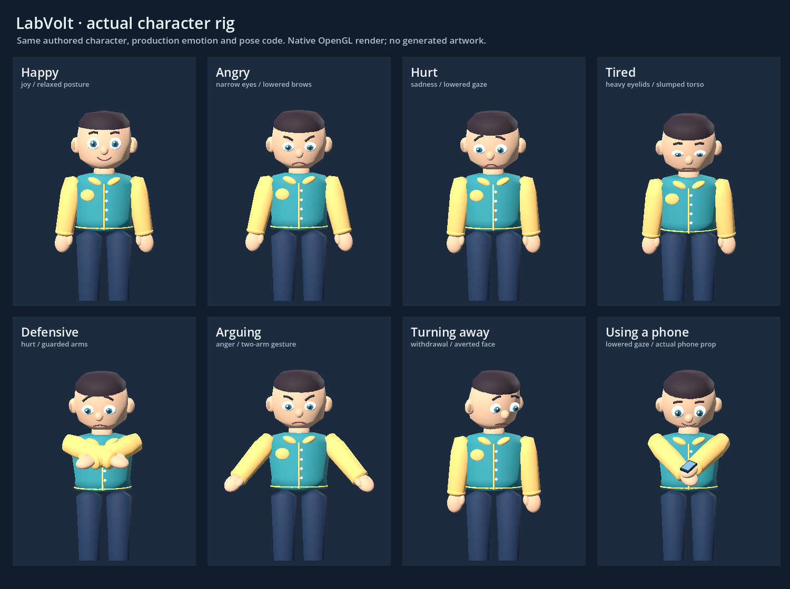

# Native character expression check



Captured and visually inspected on 2026-11-27 with Godot 4.7.2's native
Compatibility renderer. The PNG is the unedited output of the game viewport,
saved by `render_character_motion.gd`. The render used an isolated project with
unchanged copies of the production Toon builder, Motion code and student prop
helper. Their contents were compared with the repository before saving this
evidence. No image generation or image editing was used.

The same authored character is shown in every panel. Its base expression is
`Smile`; the short `Crop` hair keeps the eyebrows visible. Trait expressiveness
is 0.85, confidence is 0.55, and the scene records the exact affect values and
poses used for each panel. Normal walking animation is stopped to isolate the
expression layer.

## What was checked

- Happy, angry, hurt and tired faces have visibly different eyes, brows, mouths
  and head angles. Hurt and anger overcome the authored smile.
- Eye whites, irises and pupils remain attached and retain their proportions;
  no enlarged or displaced eye geometry was observed in these eight states.
- Defensive arms close across the torso, arguing uses both arms, turning away
  averts the face, and the phone pose holds the actual student phone prop near
  the body with a lowered gaze.
- Lip and brow links retain continuous curves while their expression changes.

The first render exposed retained smiles on hurt faces and overly open phone
and defensive arms. Those production targets were corrected, rendered again
and inspected. The final image also verifies the connected eyebrow deformation.

The focused native `test_character_worldviews.gd` regression passes on Godot
4.5.1 Mono after these corrections. It checks expression recovery, joined lip
endpoints, unsheared lip bases, eye proportions and a phone pose whose hands
remain close together. This image is a static comparison, not evidence of a
live provider's conversation quality or of every walking/speaking combination.

## Reproduce

Use the game's normal Godot runtime on a rendering display:

```sh
godot --path . --rendering-method gl_compatibility \
  res://docs/verification/character-overhaul/character_motion.tscn
```

The scene saves `character_motion.png` beside the probe and exits. An optional
absolute output path can follow `--`. A real display or an existing software
X server is required; the probe rejects Godot's headless dummy renderer rather
than treating an empty capture as visual verification.
