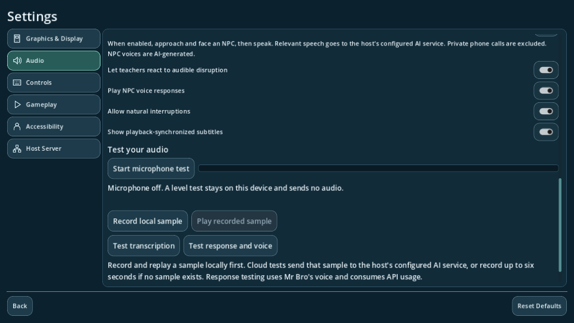
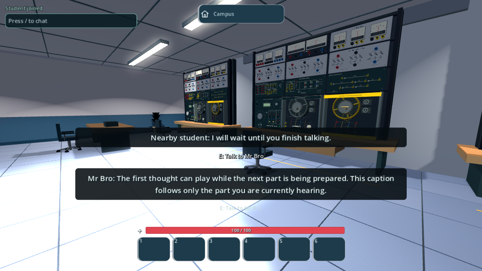

# NPC AI, microphone and speech reliability overhaul

Verification date: **2026-11-27, America/Los_Angeles**.

The implementation and automated verification are complete for the available Linux environment. **Physical microphone operation, real-provider conversations, human-audible voice quality and a standalone Windows executable remain unverified.** This report does not label those essential acceptance checks complete.

Work started at `c8e50fb5e046b941fa8ad74d9e01108a77149ef7` on `windows-launcher`. Intermediate checkpoints were published and read back from GitHub on `dev/npc-voice-reliability-20261127`:

| Checkpoint | Changes |
| --- | --- |
| `c27d6dddc151c6177f8570b8b5d92c9b7424ecd7` | Preserve unsaved student social state and retry failed durable writes |
| `62a37a020788094fad198dd6e3f6314f1f9c0be3` | Require authenticated durable receipts for portable student updates |
| `16e252089ab43b9473f77a59136b7e618995660f` | Budget optional NPC conversations around players and foreground work |
| `fcd2ff9e4dbf721731fedb3f86bff77c45a9fc95` | Integrated streaming, microphone, speech, conversation cancellation, accounting and executable acceptance tools |
| `bb0cb79137bf9fc0b989905cad3ea2320fb24d33` | Distinct speech retry attempts, fixture provenance, standard metadata and complete verification evidence |

The final integration preserves the intervening primary commit described below. Its exact merge commit is the containing Git revision; final branch verification is reported with the handoff. No force-push, unrelated branch deletion or source reset was used.

## Evidence and scope

- [results.json](results.json) contains the consolidated latest results for **76 distinct native regression cases**, all passing (72 NPC/audio cases plus four integration checks for the intervening calculator changes), plus separate HTTP/WebSocket, ENet, recorded-audio, startup, storage and packaged-resource results.
- [benchmarks.json](benchmarks.json) preserves paired preprocessing samples, the synthetic speech scheduling benchmark and the request-count comparisons.
- [Student and storage audit](../npc-audio-repair/student-storage-audit.md) records the durable-save, multiplayer, seating and manual-session investigations in more detail.
- [Voice acceptance instructions](../../../tests/campus/academics/VOICE_ACCEPTANCE.md) describe runnable capture-only, real-provider and complete NPC conversation checks.

Native execution used **Godot 4.5.1 Mono and .NET 8 on Linux**. Tests used disposable user data. The actual C# project built with zero warnings and zero errors. Network tests used real loopback HTTP/WebSocket sockets or actual ENet peers; provider language and audio responses in those tests were authored fixtures. The menu test ran the actual relay Worker and DurableObject through local Wrangler.

Linux cannot load this repository's Windows-only CEF extension. The three known extension-loading messages were separated from script and unexpected runtime errors. The checks do not excuse those errors on Windows.

## Confirmed issues and repairs

### Microphone capture and transcription

| Confirmed cause | Repair and verification |
| --- | --- |
| Explicit push-to-talk depended on automatic VAD, discarding quiet speech or ending a turn during a pause | Start explicit turns on press and finish on release. Preserve pauses while held. Reject digital silence and isolated impulses using the native signal check. Quiet, silence, long-pause and repeated-turn regressions pass. |
| Capture/device restart could combine audio from different input sessions | Track the capture generation and cancel the old turn when it changes. Lifecycle tests exercise real AudioServer capture with independent consumers. |
| An STT failure arriving before its input-item commit acknowledgement could be dropped | Retain and correlate early terminal events with the acknowledged item. Late or wrong-item events cannot publish another turn's transcript. |
| Long recordings performed costly PCM resampling and WAV assembly on the game thread | Move 16-to-24 kHz conversion into a native C# worker and use native buffer append for WAV assembly. Output is byte-identical to the frozen previous algorithm; timings are below. |
| Replayed turn messages could re-enter the NPC path or deliver a completed turn again | Use bounded per-peer turn-token history and explicit completion guards. Duplicate/canceled-turn tests pass. |
| Recording duration could consume the subsequent STT/generation timeout | Measure inactivity within each processing stage and identify incomplete recording uploads separately. |
| Microphone testing lacked local sample playback and could reject quiet samples using VAD | Add local recording, sample replay and explicit cloud testing of that same sample. Tests verify one selected-sample upload and cancellation. Raw microphone samples remain in memory. |
| Human-voice packets arriving together were discarded by a 10 ms arrival gate | Replace that gate with a per-speaker token bucket with a bounded burst. The ordinary batching regression accepts 100 of 100 packets; the previous gate would retain 25 in that scenario. Flood and peer-isolation bounds remain. |

The included spoken WAVs contain original synthetic test phrases; they are not private player recordings. The new recorded-audio harness sends them through the **actual AudioServer capture bus**, native PCM processing, PTT targeting, host NPC queue, production interaction/memory code, provider transport, speech player and captions. It does not inject a transcript into the NPC or call dialogue generation directly.

The three-turn loopback-provider run passed. It produced a non-silent captured waveform on every turn, exactly one transcription per turn, the earlier nickname in the second turn's actual request context, a matching follow-up response, advancing playback positions, captions, delivery completion and released resources. The fixture returned known transcripts and synthesized test waveforms, so this proves orchestration and delivery, not recognition accuracy or natural speech quality.

The real-provider mode was invoked without credentials and correctly returned **`unavailable`, exit 2, with no API request**. The environment exposed no physical audio device. A dummy device label is not evidence that physical capture or output worked.

### Conversation identity, queues and cancellation

Manual typed and recorded questions previously lacked a session-specific context. Closing and reopening the same NPC could therefore accept an old completion; a duplicate recorded upload could start work twice.

The inspector now establishes a random per-peer conversation nonce, increasing turn number and unique request ID. The host validates the player's identity and selected room, class and NPC before admitting work. Reliable begin/question/end RPCs preserve ordering. Recently retired nonces are bounded, and reconnect cleanup removes the old peer's state.

The same validity guard reaches queued provider work, STT, input/output moderation and character generation. A conversation closed while waiting for a provider lane is canceled before dispatch. Closing or switching cancels the exact speech serial and removes its caption state. A canceled serial is remembered long enough to reject a speech envelope already in transit. An old coroutine retains its reservation until it exits, preventing it from releasing a newer request's reservation.

These changes were verified in **36 checks using the actual Main UI and character pipeline**, and in **two separate ENet processes**. Cases include teacher and student close/reopen, switching NPCs, duplicate WAVs, delayed STT/model completion, stale UI status, late audio envelopes and independent host/guest queues. The older inspector ENet test also passes after its fixture performs a real new UI selection when the old selection is invalidated.

The approximate ten-second “cannot connect to host” report was not reproduced as one specific current defect. The inspected NPC path had other timing and cancellation defects described here. Connection establishment, generation, transcription, queued work, playback and final accounting now have distinct state and error handling. The text transport has a 15-second connection bound, ordinary character generation has a 60-second deadline, and complex/visual requests retain a separate longer bound. This is not evidence that arbitrary WAN or provider failures have been eliminated.

### Speech generation and playback

| Confirmed cause | Repair |
| --- | --- |
| Verified audio waited for terminal Live accounting, potentially adding the five-second close timeout | Hand validated audio to the scheduler immediately while the transport drains final accounting once. |
| Long responses waited for a complete single render | For qualifying responses over 420 characters, split at a completed thought and render at most two parts. Start part two once part one is verified. Short responses remain one render. |
| Timeout, transcript mismatch or uncertain generation failure could trigger another potentially billable render | Retry only explicit safe rejections such as rate limiting. Cap attempts; do not automatically regenerate unknown outcomes or rejected spoken content. |
| Active synthesis could outlive the pending-job timeout | Add an active-job watchdog and reject late completion after cancellation/timeout. Preserve written dialogue. |
| New scheduler instances or retry attempts could reuse request IDs | Add a random instance component and separate retry-attempt IDs, with a stable job correlation and recorded retry count. Cancellation targets the current attempt. |
| A transcript match could accompany silent audio | Reject all-zero PCM in Realtime/Live and REST/chat speech decoding. Transcript validation and numeric-value checks remain. |
| Canceling one listener could affect another listener or unrelated final accounting | Cancel the exact utterance and retain shared synthesis while another listener needs it. A completed job may finish accounting without being treated as an orphan. |
| Cancellation during graceful close could return an already completed clip | Recheck cancellation after the close drain; canceled audio cannot be returned or replayed. |
| Missing or rejected speech usage was reported incorrectly or lost | Keep missing usage unknown. Retain observed usage on mismatch, silence, failure and cancellation. Process terminal Realtime accounting during a bounded close drain without permitting late audio. |
| A failed second segment could clear the client's still-arriving first segment | Finish sending the first valid segment before delivering fallback. Ordered assembly keeps out-of-order arrivals separate and does not replay the combined cache. |
| Enabling captions during speech or resuming could leave captions missing | Restore captions at the actual playback position, retaining private/hidden-caption choices. |
| A missing playback completion could leave an utterance stuck | Add a playback watchdog and avoid reporting failed playback as delivered. |

Segmented synthesis is a deliberate **latency/cost tradeoff**: a qualifying long response uses two TTS requests instead of one. The same assigned voice and performance instructions are retained, with phrase offsets adjusted for each part. Full-response caching avoids a second playback or a redundant full render. A failure after the first part leaves the played part intact and displays the unread remainder.

The real two-process ENet test checks reconstructed PCM hashes, private recipients, out-of-order parts, pause/resume, cancellation and stale sessions. Its partial-failure case sends a **960 KB first segment while the second segment fails**. Both peers passed; the first segment arrives completely before fallback.

The five-case HTTP/WebSocket suite exercised real adapters against a local provider fixture. It observed **17 renders, 3 transcriptions, one voice creation, peak three active voice sessions and zero active sessions at completion**. Rejected, silent and canceled speech retained the fixture's reported 100 input and 40 output tokens. Those are fixture numbers, not real provider charges.

### Text transport, context and AI usage

The host now incrementally consumes Responses and Chat SSE. It handles fragmented UTF-8, duplicate sequence numbers, final usage, cancellation, incomplete streams and bounded response size. It measures connection, headers, first text and total duration from actual events. A disconnected partial response cannot become final character dialogue or trigger a blind retry.

**NPC text and speech still require a fully validated structured character response.** Early transport text is measured but is not shown or spoken as unvalidated dialogue. Speech begins as soon as its first completed, transcript-validated part is available; arbitrary partial model JSON is not spoken. This preserves semantic, assessment, moderation, character-memory and technical-value checks. A fully native Live speech-to-speech replacement was not enabled: no real-provider benchmark was available to justify bypassing those boundaries, and the existing retired continuous-conversation path remains disabled.

Stable trusted instructions moved to a developer prefix. Supported modern model families use explicit cache breakpoints for that reusable prefix; changing mood, dialogue and retrieved memories remain outside that cache write. Current provider cache-write fields are parsed, including retention-specific totals. Unknown retention splits do not produce a fabricated price.

The existing rich dossier architecture remains: persistent full biographies, compact character core, local retrieval, bounded recent dialogue, shared personal canon, private per-player memories and selective repair of contradictory sections. Routine dialogue already used one combined model generation in the baseline, and continues to do so. No new reduction from multiple routine generations to one is claimed. Assessment classification and bounded consistency repairs remain where needed.

Two unnecessary sources of background work were corrected:

1. Optional classmates could request language or speech with no player audience. They now require a nearby human in the room, share four optional generated turns per rolling minute, and yield to foreground questions. Each side of an exchange consumes a turn. Movement, studying, scheduling, seating and other deterministic behavior continue locally.
2. `listen_only` was checked after preparation had already generated a reply that would be discarded. The new regression failed before the repair. Listening now records local perception and memory with zero provider calls. Actual generated replies retain their input/output moderation.

Dossier expansion is relevant to nearby characters or explicitly requested instructor creation. It does not expand an empty campus indefinitely. Publication waits while a character is in an active conversation, retaining the completed validated draft and its accounting; it does not pay to regenerate that draft. Nonretryable authentication/configuration failures stop instead of repeatedly regenerating a biography. The new budget/publication test passes 16 checks, alongside existing generation, canon-race and durable-store tests.

The optional diagnostics window now includes bounded active/recent request records and session totals: request/correlation IDs, subsystem, purpose, player/background origin, model, queue and operation duration, status, cancellation, retry count and provider-reported usage. Text/cache/reasoning/audio categories remain distinct. File STT preserves its HTTP status; streaming STT preserves conversion, connection, commit, first-delta and total timing. Catalog and voice-creation operations are visible without inventing token charges. Credentials, authorization headers, callbacks, raw recordings and conversation text are excluded from the request journal. Settings and aggregate usage persist under `user://`.

## Measured performance and request-count changes

### Native audio preprocessing

Five samples per operation. Previous and new outputs matched byte for byte.

| Recording | Resampling median before | After native conversion | WAV assembly median before | After native append |
| --- | ---: | ---: | ---: | ---: |
| 1 second | 4.902 ms | 0.283 ms | 1.039 ms | 0.021 ms |
| 10 seconds | 47.131 ms | 2.910 ms | 9.390 ms | 0.207 ms |
| 30 seconds | 152.444 ms | 8.108 ms | 29.504 ms | 1.048 ms |
| 180 seconds | 863.989 ms | 53.205 ms | 164.940 ms | 3.248 ms |

The production worker submitted the 180-second conversion in **1.704 ms**, completed in **50.181 ms** and allowed nine frames to advance. These are local CPU measurements. They do not measure provider, microphone endpoint, network or device-output latency.

### Controlled speech scheduling experiment

The fixture uses a 570-character response, a generation delay of `30 ms + 0.1 ms/character` and 150 ms of final accounting delay. Five samples per path:

| Metric | Whole render followed by final accounting | First verified part with prefetch |
| --- | ---: | ---: |
| Median first scheduled playback | 236.807 ms | 42.717 ms |
| p95 first scheduled playback | 251.495 ms | 43.310 ms |
| Requests per turn | 1 | 2 |

The first sample in each mode was 201.041 ms and 42.523 ms respectively; these are first fixture samples, not real cloud cold starts. Full segmented finalization remained about 276 ms. The experiment demonstrates removal of a scheduling dependency, **not a measured OpenAI speedup or cost saving**.

The actual loopback SSE fixture delivered first text at 2 ms and finished at 154 ms, with an authored 150 ms completion gap. The three-turn recorded pipeline reached scheduled audio 394, 392 and 381 ms after capture completion. These are also fixture measurements, not live-service estimates.

### Usage results

| Workload | Verified comparison |
| --- | --- |
| Ordinary valid text reply | Baseline and current: one combined generation plus two moderation calls |
| Listening to an already delivered NPC reply | Before: one unused generation plus input moderation; after: zero provider calls |
| Unobserved optional classroom work | 1,200 scheduler ticks after the change: zero optional generations |
| Observed optional classroom work | Four generated turns per rolling 60 seconds campus-wide; player work uses its separate priority path |
| Duplicate recording delivery | One STT admission per unique turn; repeated upload rejected |
| Held validated dossier | One generation; publication after conversation adds zero generations |
| Long speech | One to two render requests in exchange for earlier playback |

No real API token consumption, cache-hit rate, invoice total, hourly idle cost or live-model percentile was measured. The diagnostics now supply those measurements during a credentialed run. No theoretical dollar savings are presented as measured results.

## Character quality, student persistence and UI

Deterministic character regressions preserve all 21 teacher profiles, shared personal facts across players, privacy of per-player transcripts, imperfect personality/independent traits, emotional transitions, silence/refusal choices, assessment boundaries, actual grader outcomes, visual actions and local solvers. The consolidated results include 4,878 facial-compositor checks and 583 actual-gameplay checks. Personal facts such as a remembered training record remain consistent through rephrasing and reload. The new multi-turn audio fixture also verifies nickname recall through the real context builder.

These checks establish contracts and gameplay consistency. They do not establish that a current external model sounds human, teaches well, recognizes accents or produces expressive and distinct voices. Those qualities still require credentialed conversation and listening.

The archive durability regression uses a real blocked staging-file path; six of its 11 checks failed before the repair and all 11 passed afterward. Portable sync now acknowledges a matching durable disk receipt rather than just a reliable network packet. The receiving client can fail its save, recover, receive the same update and reload it from disk. The actual ENet normal and failed-save modes pass. Four departure modes also pass, including a missing-receipt case that honestly returns `saved=false` rather than claiming persistence.

Existing seated orientation, chair collision/claim, NPC relocation, classroom eligibility and world-integration behavior was inspected and exercised. The current seating tests passed; no speculative rewrite of working orientation or seat ownership was introduced.

The Character Voices interface was populated and its identity, preview, save/load and cancellation contracts passed. An old layout test expected an obsolete hierarchy already present in the baseline. It now checks named controls, usable regions and scroll reachability, and passes at 1060×660 and 720×460. Native Studio screenshots were also inspected.

Microphone settings and subtitle screenshots were rendered and inspected at 1280×720 and 960×540. Caption placement now uses available vertical regions so it clears the central prompt, held-item prompt, health and hotbar. Captions advance with the actual segment playback lifecycle, including pause/resume and enabling captions mid-speech. The logical 1280×720 canvas scales to the smaller physical framebuffer.





## Runtime storage and packaged resources

Production NPC dossiers, memories, students, voices, usage, preferences and speech temporary files use `user://` or the appropriate application-data location. No production writer to a source `res://` path was confirmed. Existing launcher install/cache paths use Windows Local Application Data. The editor preview plugin's temporary scene belongs under `.godot`; it is distinct from runtime memory storage. The launcher import/build bootstrap was not removed merely to conceal development metadata.

Two consecutive runtime workloads each hashed **6,920 tracked files** and checked newly untracked files:

| Workload | Runtime | Isolated files created | Repository changes | Unexpected errors |
| --- | ---: | ---: | ---: | ---: |
| Actual Main manual-conversation lifecycle | 14.262 s | 101 | 0 | 0 |
| Portable students, voice profiles, speech temporary data and playback cache | 4.419 s | 68 | 0 | 0 |

Ignored engine build/import caches are explicitly outside that assertion. No blanket Git ignore rule was added to hide runtime data. The reusable `verify_runtime_storage.py` can wrap the actual Windows executable when available.

Normal editor import also exposed missing standard Godot metadata. The final checkpoint includes 49 source-paired sidecars (37 script UIDs, nine image descriptors and three WAV descriptors), following the repository's existing convention. A second import with the .NET SDK correctly on `PATH` hashed all 7,003 tracked and unignored untracked files and produced zero changes, zero new files and zero unexpected errors in 25.929 seconds. The first import's SDK-discovery errors are recorded separately; they were corrected, not treated as expected CEF messages. Nineteen UID values subsequently adopted the canonical values in the intervening primary-branch commit so integration preserves its resource identities.

An actual Windows executable export attempt was blocked by missing Godot Windows debug/release templates. A Windows-preset **resource-pack export did succeed**, producing 119,888,732 bytes with no script/compile errors. A release managed publish succeeded. Using that PCK, the published assembly and an external Linux Mono runtime scaffold, both actual menu routes and the voice playback lifecycle passed without unpacked production scripts. The additional packed segment-route harness requires a test helper intentionally excluded from production, so that harness did not run successfully from the pack.

The PCK was built at the implementation checkpoint before the final retry-metadata follow-up. It verifies packaging/remaps and scene integration for that snapshot. It does not verify a standalone Windows executable, Windows CEF, native device APIs or launcher behavior on Windows.

## Integration with the current primary branch

While this work was being finalized, `windows-launcher` advanced to `a561dcfab33909505454b3769e46fc6393bbcac3` with calculator and equation-editor changes. There were no overlapping production source edits. The integration preserves all 43 incoming changed files byte for byte, including its 19 canonical script UIDs and seven image import descriptors. The merge also records the normal `CalculatorMath.Symbolic.cs.uid` sidecar required by the new C# source.

The combined native assembly rebuilt successfully in 8.803 seconds with zero warnings and zero errors. All four relevant incoming-feature regressions passed: desktop calculator, configured calculator in Main, paper workspace/equations and pencil calculator. They completed in 19.20 seconds with zero unexpected errors. Both Singleplayer and Host menu routes then passed against the actual local relay; game execution took 17.032 seconds (22.114 seconds including relay setup).

The final normal editor import fingerprinted all **7,005 tracked files** and found zero modified files, zero new files, zero unignored untracked files and zero unexpected errors in 24.868 seconds. All 43 incoming files still matched the primary commit. The prior combined import's strict cleanliness check correctly failed when it first generated the missing C# UID; that metadata was then included before this clean verification. No primary code was overwritten and no ignore rule concealed generated data.

## Remaining acceptance and reproduction

The implementation is ready for these remaining environment-dependent checks:

1. Physical default/alternate microphone capture, OS permission denial, unplug/replug and repeated recording.
2. Actual provider transcription of the included recordings and a real person's speech.
3. Real NPC-generated TTS, listening for assigned voice identity, expression, technical correctness and audible timing.
4. Several complete conversations with different NPCs and selected models, including memory follow-up, interruption, switching and multiplayer participants.
5. Standalone Windows export, CEF, launcher, save/reload and runtime-write checks.
6. Real cold/subsequent latency, token/cache/audio usage and cost comparisons, including any proposed native Live speech-to-speech alternative.
7. Sustained memory and frame-time profiles, prolonged idle/concurrent-provider workloads and real WAN multiplayer conversations. Short bounded local regressions do not substitute for those soak tests.

The new harness exits with an explicit unavailable result when a required prerequisite is missing. It does not accept an API key on the command line, save raw physical recordings or mark human listening as verified automatically. Set the key in the process environment and run from a built Godot Mono checkout:

```sh
# Local recorded-audio regression with authored loopback providers.
python tests/campus/academics/run_recorded_voice_pipeline.py --godot GODOT_MONO --output /tmp/labvolt-recorded-pipeline

# Real microphone and actual configured provider chain; speak on cue.
python tests/campus/academics/run_voice_acceptance.py --godot GODOT_MONO --source microphone --live --turns 3 --seconds 6 --teacher mr_bro --output /tmp/labvolt-live-voice

# Repeat with another character and the desired explicit model selections.
python tests/campus/academics/run_voice_acceptance.py --godot GODOT_MONO --source microphone --live --turns 3 --seconds 6 --teacher dr_volts --output /tmp/labvolt-live-voice-second
```

Replace `GODOT_MONO` and output paths for the local operating system. See the acceptance guide for capture-only, STT-only, device selection and model flags. Live mode makes billable requests; the runner reports actual provider evidence separately from local measurements.

## Primary protocol references

The implementation preserves player model choices and follows the capabilities documented for the selected provider rather than assuming all speech models share one protocol:

- [Responses streaming](https://developers.openai.com/api/docs/guides/streaming-responses)
- [Prompt caching](https://developers.openai.com/api/docs/guides/prompt-caching)
- [Transcription](https://developers.openai.com/api/docs/guides/transcription)
- [Realtime transcription](https://developers.openai.com/api/docs/guides/realtime-transcription)
- [Realtime client events](https://developers.openai.com/api/reference/resources/realtime/client-events)
- [Realtime server events](https://developers.openai.com/api/reference/resources/realtime/server-events)
- [Live conversations and final accounting](https://developers.openai.com/api/docs/guides/live-conversations)
- [Text to speech](https://developers.openai.com/api/docs/guides/text-to-speech)
- [Custom voices](https://developers.openai.com/api/docs/guides/custom-voices)

The full dossier, gameplay, numeric-speech and privacy checks remain in front of delivered language. No recorded fixture, test tone, estimated price or local packet timing is substituted for real-provider or hardware acceptance.
